# ThreatAssessor v4.0

**Professional Threat Modeling & Security Assessment Platform**

A comprehensive, single-page web application for conducting structured threat modeling assessments against banking, enterprise, and application environments. Built for penetration testers, security consultants, and threat modeling professionals.

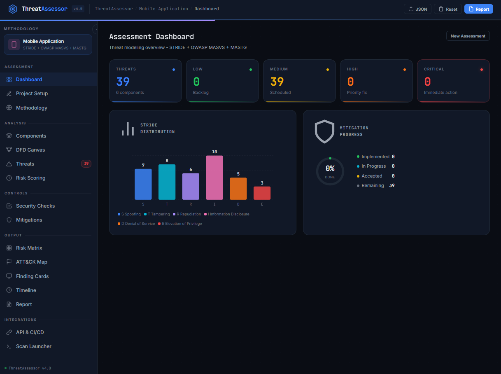

---

## Features

### Core
- **Multi-Project Support:** Create, switch between, and manage multiple assessments independently
- **10 Methodologies:** Web Application, API Security, Mobile (Android/iOS), Cloud Infrastructure, Network Infrastructure, IoT/Embedded, Microservices/Containers, CI/CD Pipeline, AI/ML Systems, Privacy Impact Assessment
- **STRIDE Threat Modeling:** Spoofing, Tampering, Repudiation, Information Disclosure, Denial of Service, Elevation of Privilege
- **STRIDE-per-Element:** Automatic threat filtering based on component type
- **Auto-Framework Assignment:** Maps compliance frameworks (OWASP, NIST, PCI DSS, etc.) based on methodology

### Visual Threat Modeling
- **DFD Canvas:** Data Flow Diagram editor with Microsoft Threat Modeling Tool-compatible stencils
- **44 Stencil Types:** Generic Process (15), External Interactor (9), Data Store (10), Data Flow (10), with drag-and-drop placement
- **Auto-Beautified Connectors:** Bezier curve connections that automatically curve based on anchor direction, with auto-spread for multiple connections between same components
- **8 Anchor Points:** Connect from any edge or corner of a component (top, top-right, right, bottom-right, bottom, bottom-left, left, top-left) - visible on hover
- **Reroutable Endpoints:** Click a selected connection's endpoint to reroute it to a different anchor point
- **Drag to Bend:** Grab any connector line and drag it to bend freely
- **Right-Click Menu:** Delete, reconnect source/target, reset curve on any connector
- **10-Step Undo:** Ctrl+Z support for all canvas actions (move, connect, bend, add, delete)
- **Scan Result Import:** Parse and import findings from OWASP ZAP, Nuclei, Trivy, and Semgrep JSON output directly as threats with auto-mapped DREAD scores

### Risk Analysis
- **DREAD Scoring:** Damage, Reproducibility, Exploitability, Affected Users, Discoverability
- **5x5 Risk Matrix:** Interactive Likelihood vs Impact heat map with clickable drill-down panels
- **MITRE ATT&CK Heatmap:** Technique-to-tactic mapping with coverage analysis, gap identification, and clickable detail panels
- **Finding Cards:** Filterable threat cards by severity and STRIDE category

### Compliance & Reporting
- **Security Checks:** Methodology-specific compliance checklists
- **Mitigation Tracking:** Framework-based recommendations with status tracking
- **Assessment Timeline:** Chronological activity log
- **Executive Report:** Slide-based presentation with cover page, executive summary, architecture overview, risk matrix, STRIDE distribution, compliance status

### Integration & Automation
- **API Key Management:** Secure key generation with expiry, revocation, and environment variable support
- **CI/CD Integration:** Ready-to-use curl commands, GitHub Actions, GitLab CI, Jenkins, Azure DevOps templates
- **DefectDojo Integration:** Push findings directly to DefectDojo with test connection verification
- **Scan Launcher:** Orchestrate external scanners (OWASP ZAP, Nuclei, Trivy, Semgrep, etc.)
- **Scan Result Import:** Upload or paste scan output (JSON/JSONL) from ZAP, Nuclei, Trivy, Semgrep and auto-import as threats with DREAD scoring and STRIDE mapping

---

## Screenshots

### Dashboard

*Assessment dashboard with threat distribution, severity breakdown, STRIDE analysis, and mitigation progress*

### Project Setup
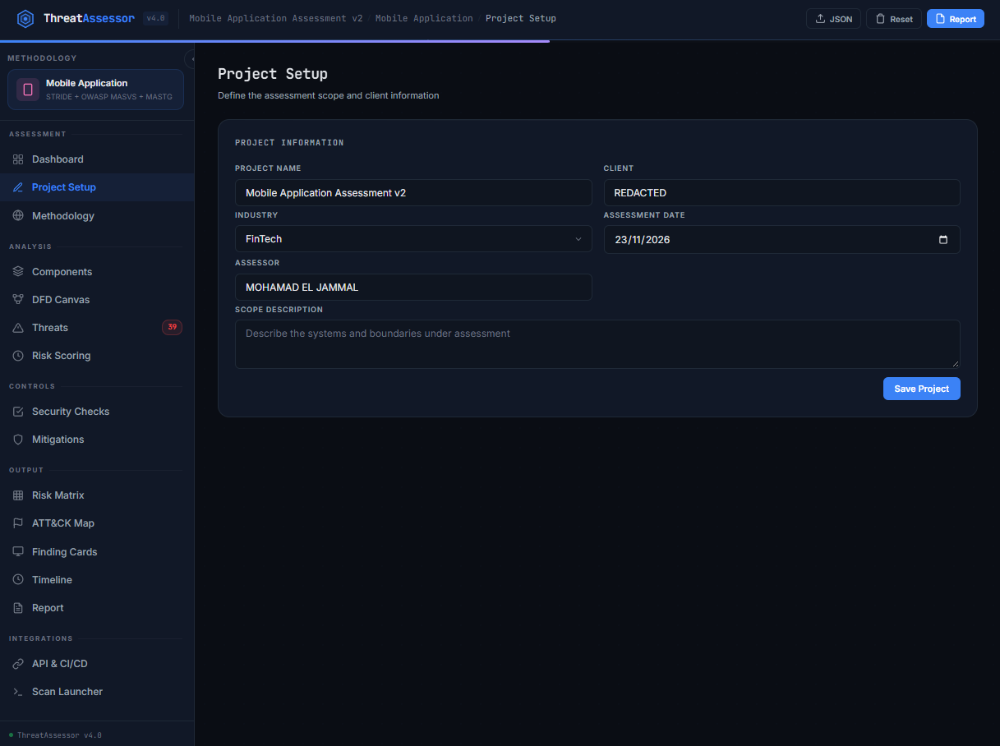
*Define assessment scope, client information, industry, and assessor details*

### Methodology Selection
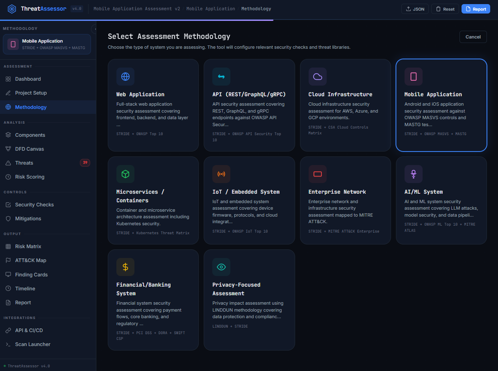
*Select from 10 pre-configured assessment methodologies with auto-loaded security checks*

### DFD Canvas
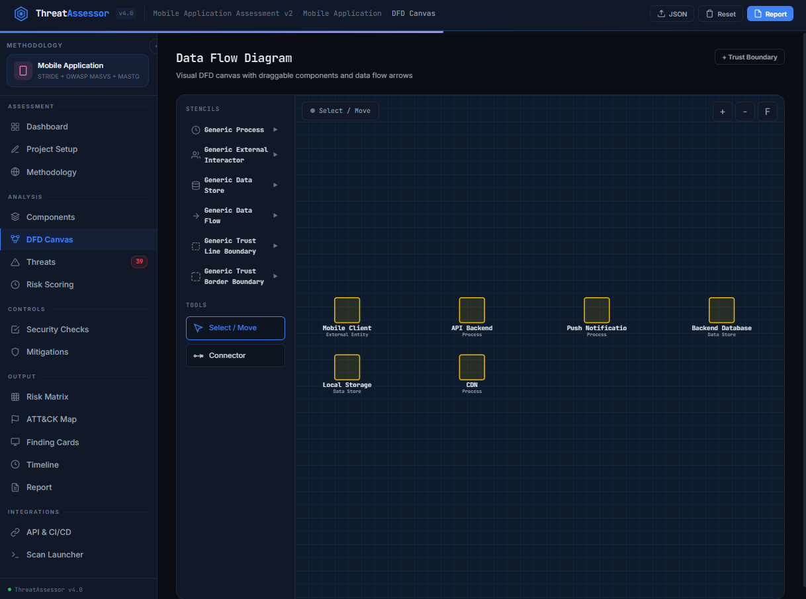
*Data Flow Diagram editor with Microsoft TMT-compatible stencils and bezier curve connections*

### Threat Analysis
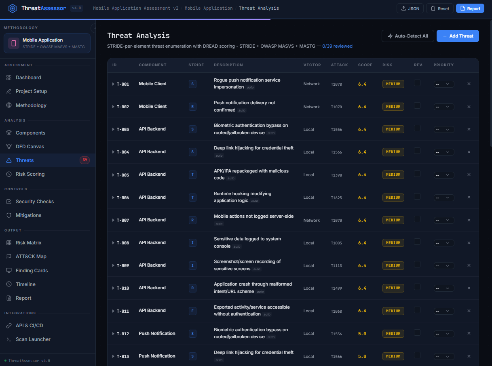
*STRIDE-based threat identification with DREAD scoring and ATT&CK technique mapping*

### Risk Scoring
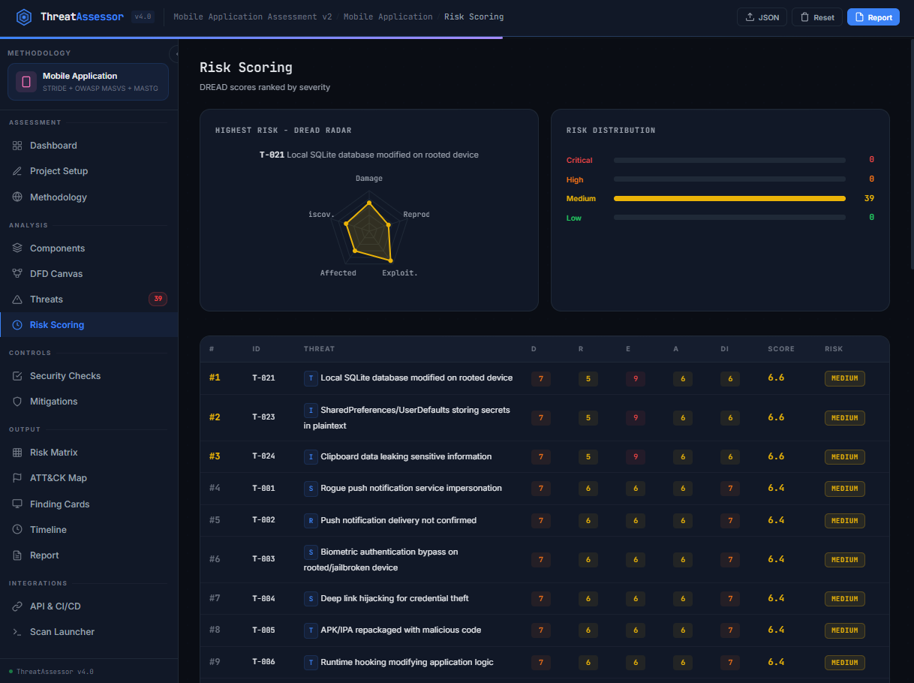
*DREAD risk scoring with per-threat damage, reproducibility, exploitability, affected users, and discoverability*

### Security Checks
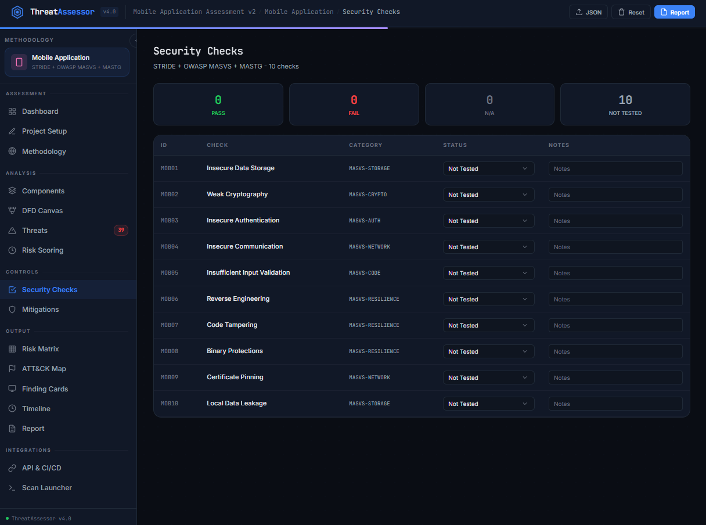
*Methodology-specific security control checklists with pass/fail/N/A tracking*

### Mitigations
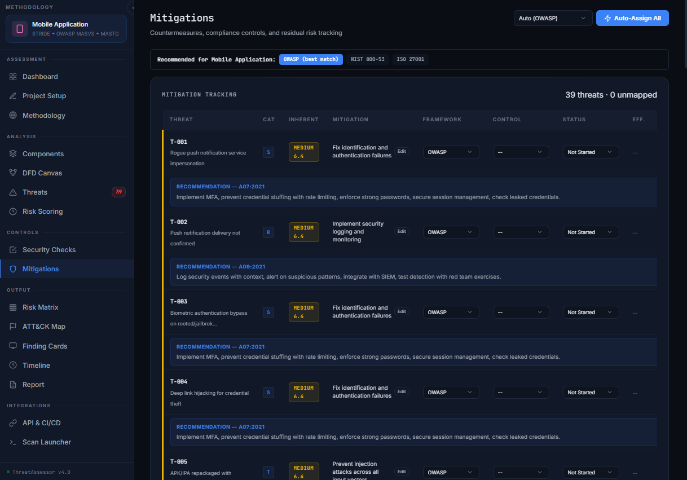
*Framework-based mitigation tracking with auto-assigned compliance recommendations*

### ATT&CK Heatmap
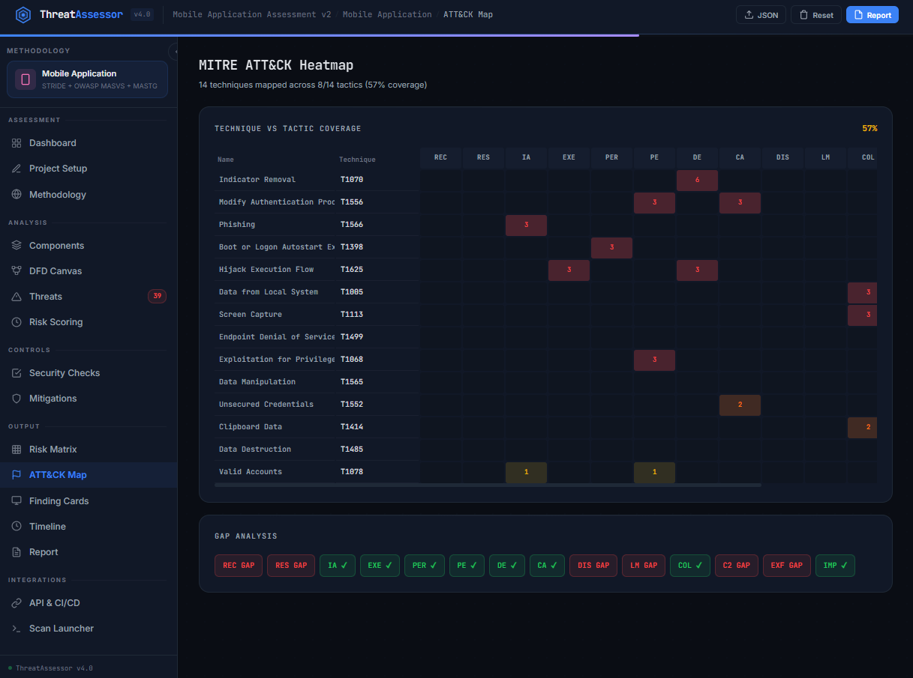
*MITRE ATT&CK technique coverage across 14 tactics with gap analysis*

### Executive Report
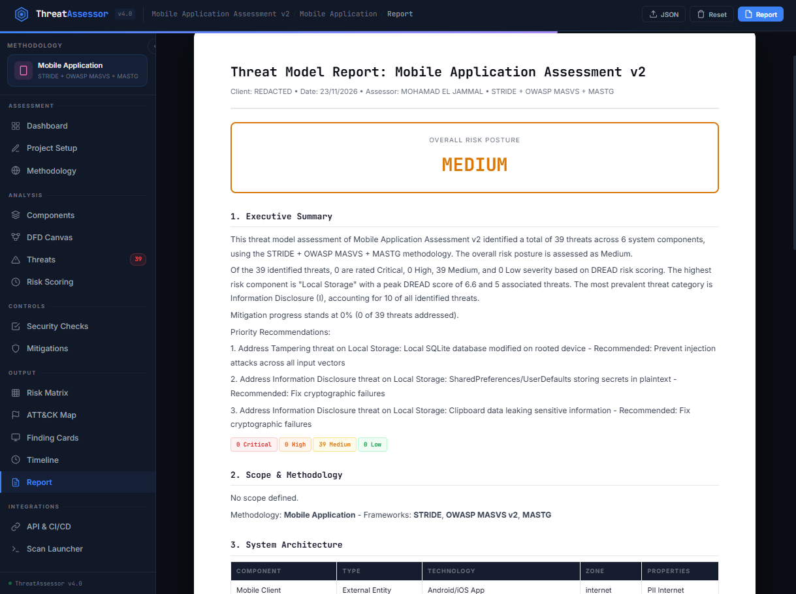
*Presentation-ready executive report with slide navigation*

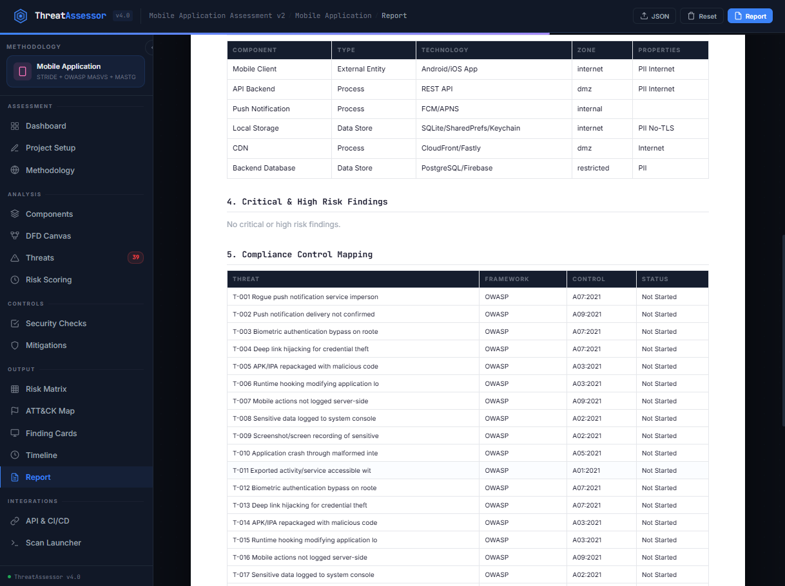
*Executive summary with risk posture, severity breakdown, and key findings*

### API & CI/CD Integration
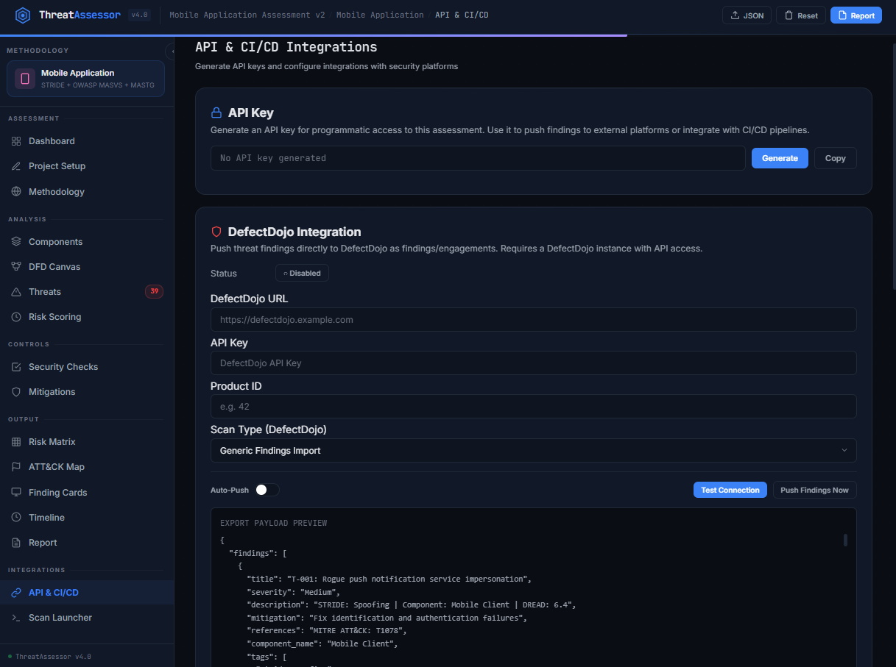
*API key management, CI/CD pipeline templates, and DefectDojo integration*

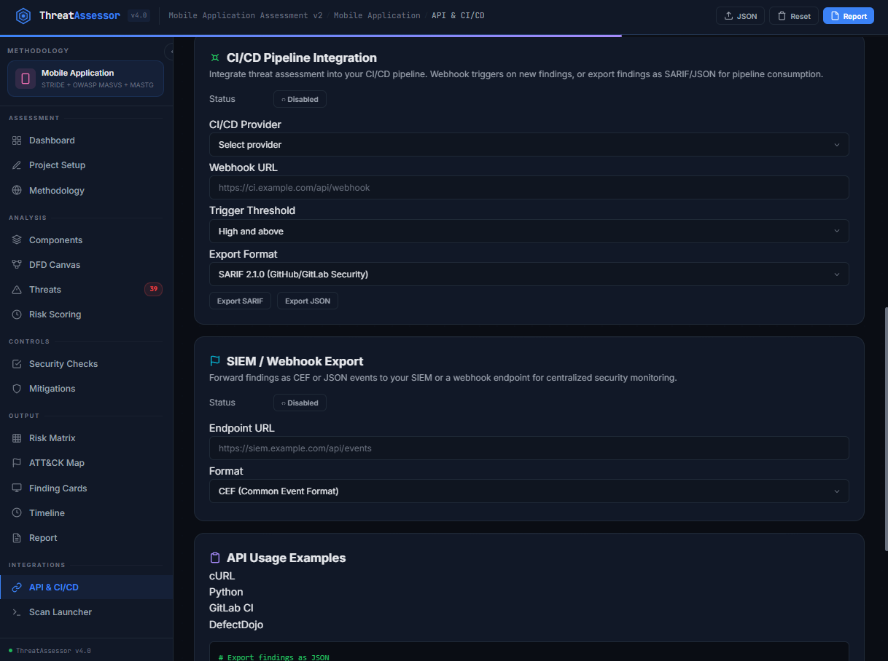
*Generated curl commands, environment variables, and webhook configuration*

### Scan Launcher
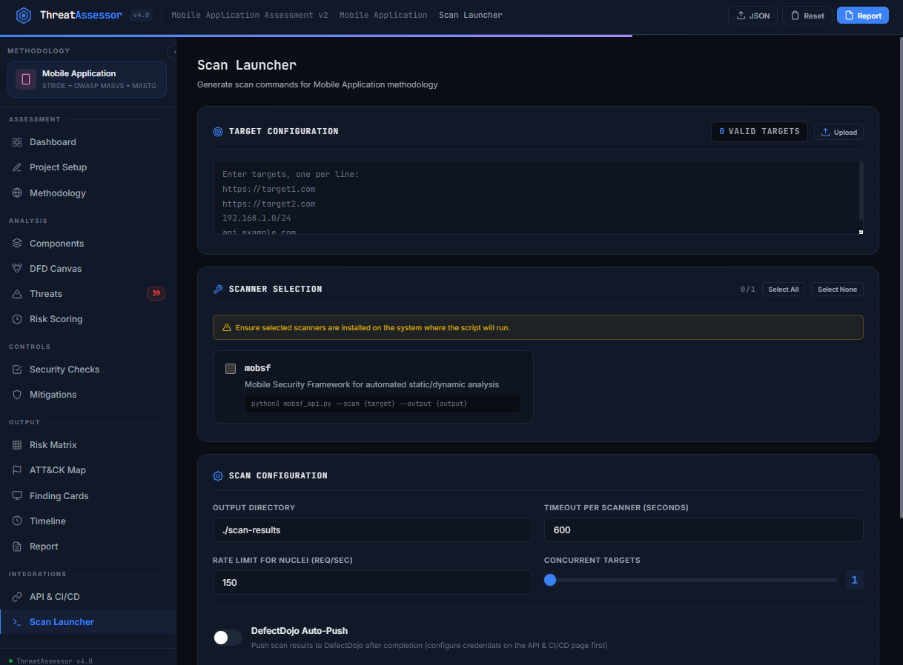
*Scanner selection and orchestration for OWASP ZAP, Nuclei, Trivy, Semgrep, and more*

---

## Getting Started

### Quick Start (Static HTML)

1. **Download** the `threat-assessor-v4.html` file
2. **Open** it in any modern browser (Chrome, Firefox, Edge, Safari)
3. No server, no dependencies, no installation required

```bash
# Clone the repo
git clone https://github.com/0xS4k0us4/ThreatAssessor.git
cd ThreatAssessor

# Open in browser
open threat-assessor-v4.html
# or
xdg-open threat-assessor-v4.html   # Linux
start threat-assessor-v4.html       # Windows
```

### Docker Deployment

```bash
# Build the container
docker build -t threatassessor:v4 .

# Run on port 8080
docker run -d -p 8080:80 --name threatassessor threatassessor:v4

# Access at http://localhost:8080
```

### Docker Compose

```bash
docker-compose up -d
```

---

## Usage Guide

### Step 1: Create a New Project

1. Navigate to **Project Setup** from the sidebar
2. Fill in project name, client, industry, assessment date, assessor, and scope
3. Click **Save Project**
4. Use **New Assessment** on the Dashboard to create additional projects

### Step 2: Select Methodology

1. Go to **Methodology** page
2. Choose the appropriate methodology:
   - **Web Application:** STRIDE + OWASP Top 10
   - **API Security:** STRIDE + OWASP API Top 10
   - **Mobile Application:** STRIDE + OWASP MASVS/MASTG
   - **Cloud Infrastructure:** STRIDE + CIS Benchmarks
   - And 6 more specialized methodologies
3. Security checks and compliance frameworks are auto-loaded based on your selection

### Step 3: Define Components

1. Go to **Components** page
2. Add system components with name, type, technology stack, trust zone, data classification, authentication, and encryption settings
3. Components form the basis for threat identification

### Step 4: Build Data Flow Diagram

1. Go to **DFD Canvas** page
2. Use the stencil sidebar to add components: drag and drop onto the canvas, or click to quick-add
3. Hover over a component to see 8 anchor points (edges and corners)
4. Click any anchor to start a connection, click another anchor on the target component to complete it
5. Lines auto-curve based on anchor positions for clean routing
6. Drag any connector line to bend it manually
7. Click a line to select it, then click the blue endpoint dots to reroute to a different anchor
8. Right-click a connector to delete, reconnect, or reset its curve
9. Use **Ctrl+Z** to undo up to 10 steps

### Step 5: Analyze Threats

1. Go to **Threat Analysis** page
2. Click **Auto-Generate** to create STRIDE-based threats for each component
3. Review each threat, map to MITRE ATT&CK techniques, set severity, add notes
4. STRIDE-per-Element filtering automatically applies relevant threat categories per component type

### Step 6: Score Risks

1. Go to **Risk Scoring** page
2. Apply DREAD scores (1-10) for Damage, Reproducibility, Exploitability, Affected Users, Discoverability
3. Overall risk score is calculated automatically

### Step 7: Run Security Checks

1. Go to **Security Checks** page
2. Review methodology-specific security controls
3. Mark each check as Pass, Fail, N/A, or Not Tested

### Step 8: Define Mitigations

1. Go to **Mitigations** page
2. Click **Auto-Assign Frameworks** to map compliance controls
3. Define mitigation strategies, set status, assign owners and due dates

### Step 9: Review Results

1. **Risk Matrix:** View the 5x5 heat map, click cells to drill into threats
2. **ATT&CK Map:** Review technique coverage, click rows for threat details, identify gaps
3. **Finding Cards:** Filter and browse all findings by severity and STRIDE category
4. **Timeline:** Review chronological assessment activity log

### Step 10: Generate Report

1. Go to **Report** page
2. Navigate through slides: Cover Page, Executive Summary, Architecture Overview, Critical/High Findings, Risk Matrix, STRIDE Distribution, ATT&CK Coverage, Compliance Status, Recommendations
3. Export as PDF, DOCX, Markdown, or Slides

---

## Data Storage

All data is stored in the browser's `localStorage`. No data is sent to any external server.

- **Multi-Project:** Each project is stored independently, switch between them from the Dashboard
- **Export JSON:** Download your assessment as a JSON file
- **Import JSON:** Load a previously exported assessment
- **New Assessment:** Creates a new project (previous project is saved automatically)
- **Full Reset:** Destroys all data including API keys (requires confirmation)

---

## Security

- API keys generated using `crypto.getRandomValues()` (cryptographically secure)
- API key expiry enforcement at 5 checkpoints
- Central key destruction function for revoke, expire, and reset operations
- Shell-safe escaping for generated CLI commands (prevents command injection)
- Prototype pollution guards on import, restore, and project loading
- Import limits: 5MB file size, 500 components, 5000 threats
- XSS prevention: `esc()` function and `textContent` for all user input rendering
- Project ID sanitization (alphanumeric only)
- Allowlisted key assignment on data restore (no `Object.assign`)
- All data stored client-side only, zero network transmission
- Zero third-party dependencies, no supply chain risk

---

## File Structure

```
ThreatAssessor/
├── threat-assessor-v4.html     # Main application (single self-contained file)
├── README.md                   # Documentation
├── Dockerfile                  # Docker deployment
├── docker-compose.yml          # Docker Compose config
└── screenshots/                # Application screenshots
    ├── dashboard.png
    ├── project-setup.png
    ├── methodology.png
    ├── dfd-canvas.png
    ├── threats.png
    ├── risk-scoring.png
    ├── security-checks.png
    ├── mitigations.png
    ├── attack-map.png
    ├── report-1.png
    ├── report-2.png
    ├── api-cicd.png
    ├── api-cicd-2.png
    └── scan-launcher.png
```

---

## Tech Stack

- **Frontend:** Vanilla HTML/CSS/JavaScript (zero dependencies)
- **Storage:** Browser localStorage
- **Deployment:** Static file, Docker (nginx), or any web server
- **Size:** ~380KB single HTML file

## Browser Support

- Chrome 90+
- Firefox 88+
- Edge 90+
- Safari 14+

---

## Author

**Mohamad El Jammal**
Cyber Threat Expert | Penetration Tester

---

*Built for security professionals who need a fast, offline-capable threat modeling tool with no cloud accounts, subscriptions, or complex setup required.*
